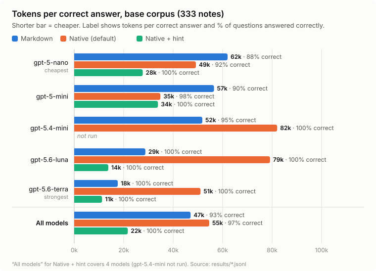
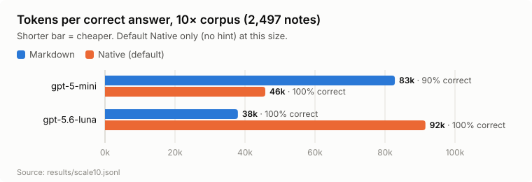

# Native vs Markdown: an independent check across 5 OpenAI models

An independent, rerunnable test of [Native](https://www.withnative.ai/)'s [Markdown benchmark](https://www.withnative.ai/research-and-posts/markdown-context-benchmark).

**443 agent runs · 5 OpenAI models · 2 workspace sizes · $9.82 in API spend.**

## 1. What Native claims, and what we checked

Native is a database for AI agents. It replaces a folder of Markdown notes (like an Obsidian vault). Their pitch: an agent answering questions about your company uses about **40× fewer tokens** with Native than when it searches a folder of notes, and fails less often.

Their own test used one model (DeepSeek) on their own company data. **We re-ran the same kind of test on 5 OpenAI models with data where we know every correct answer.** It's an independent check.

## 2. How we benchmarked it

**Step 1: invent a company.** A script ([`bench/gen_corpus.py`](bench/gen_corpus.py)) generated "Fernwork", a fake 6-person startup with 10 weeks of notes: meetings, decisions, tasks, customer calls and daily logs. That's 333 notes, plus a 10× bigger version with 2,497 notes.

The trap built into the data: **16 decisions were later replaced.** For example, "SMS reminders go through Twilio" is replaced weeks later by "we're switching to Vonage". The old note is never edited, just like real life. Native's main selling point is that it knows which note is current.

**Step 2: write 20 questions with exact answers** ([`data/questions.json`](data/questions.json)).
- **10 freshness questions:** "We decided X. Is that still current?" These test whether the agent catches the replacement.
- **6 lookups:** "Where is Kenji Watanabe based?"
- **4 two-step questions:** "Who owns the task that implements our *current* pricing decision?" The agent has to find the current decision, then the task, then the owner.

**Step 3: give the same questions to the agent in three setups.**

| Setup | What the agent gets |
|---|---|
| **Markdown** | The folder of notes, plus tools to search and read files |
| **Native** | The same notes loaded into Native, and *only* Native's tools |
| **Native + hint** | Same as Native, plus 4 lines of tips in the prompt |

**Step 4: run it.** Every question went to every setup on 5 models, from cheapest to strongest: gpt-5-nano, gpt-5-mini, gpt-5.4-mini, gpt-5.6-luna and gpt-5.6-terra. That's **443 runs for $9.82.** Each run starts from a clean slate in OpenCode, the same agent tool Native used.

**Step 5: score it.** The answer counts as right only if it contains the exact correct facts. A script checks this; there's no AI judge. For each setup we also recorded **tokens used per correct answer**, the same measure Native uses.

## 3. What the hint was, and why it mattered

Reading the Native runs, we saw the agents wasting tokens in three ways:

1. **They called `bootstrap` first.** It's Native's "here's everything about this workspace" tool, and it returns about 42,000 characters every time, even for "where is Kenji based?"
2. **Their searches broke.** Models passed `scope: "all"`, but `scope` expects a record ID, so 29% of searches errored. The agent saw that as "no results" and kept searching.
3. **Records are big.** Opening one record returned about 9× more text than reading the same note as a file.

The hint told the agent four things:
- Skip bootstrap.
- Search with just the query; leave out `scope`.
- Replaced decisions have a "supersedes" link you can look up.
- Records are large, so only open the ones you need.

The hint is a stand-in for fixes Native could make in the product itself. It isn't a suggestion that users should write prompts like this.

## 4. The data

<picture>
  <source media="(prefers-color-scheme: dark)" srcset="docs/chart-base-dark.svg">
  
</picture>

**Base corpus, % correct · tokens per correct answer (lower is better):**

| Model | Markdown | Native | Native + hint |
|---|---|---|---|
| gpt-5-nano (cheapest) | 88% · 62k | 92% · 49k | **100% · 28k** |
| gpt-5-mini | 90% · 57k | 98% · 35k | **100% · 34k** |
| gpt-5.4-mini | 95% · 52k | 100% · 82k | not run |
| gpt-5.6-luna | 100% · 29k | 100% · 79k | **100% · 14k** |
| gpt-5.6-terra (strongest) | 100% · 18k | 100% · 51k | **100% · 11k** |
| **Overall** | 93% · 47k | 97% · 55k | **100% · 22k** |

gpt-5-nano and gpt-5-mini ran each question twice on Markdown and Native; everything else ran once. "Overall" for Native + hint covers 4 models.

What that means:
- **Native is more accurate.** That's their claim, and it held. Weaker models benefit most, because Native hands them the "current" answer instead of making them work it out.
- **By default, Native cost *more* tokens.** Strong models are good at searching files, and Native's big default responses outweighed its advantage. Luna used 79k with Native against 29k with Markdown.
- **With the hint, Native won on both.** It got 100% right using about half the tokens of Markdown. Luna went from 79k to 14k.
- **Size matters.** On the 10× corpus, plain Native already beat Markdown for gpt-5-mini, with 1.8× fewer tokens. Bigger workspaces favor Native because its fixed startup cost gets spread out.

<picture>
  <source media="(prefers-color-scheme: dark)" srcset="docs/chart-10x-dark.svg">
  
</picture>

| 10× corpus (2,497 notes) | Markdown | Native (default) |
|---|---|---|
| gpt-5-mini | 90% · 83k | **100% · 46k** |
| gpt-5.6-luna | 100% · 38k | 100% · 92k |

By question type (all models, base corpus):

| | Markdown | Native | Native + hint |
|---|---|---|---|
| Freshness | 65/70 | 68/70 | 40/40 |
| Lookup | 42/42 | 42/42 | 24/24 |
| Two-step | 23/28 | 26/28 | 16/16 |

Raw tables: [`results/summary.md`](results/summary.md), [`results/summary-hinted.md`](results/summary-hinted.md), [`results/summary-scale10.md`](results/summary-scale10.md).

## 5. Friction points

Things that went wrong or confused us while setting up and using Native. Full list with evidence: [findings/friction-log.md](findings/friction-log.md).

**Website and docs**
- Googling "withnative" lands on withnative.com, a different company.
- The benchmark post's numbers don't agree with each other: "97% fewer failed trials" vs "30× fewer", and 43.5× vs 40×.
- The "Stanford research" claim is on the homepage but isn't linked from the benchmark post.

**Setup**
- The build was quick: 3 minutes and about 4 GB. That's a positive.
- The setup guide's first check (`engine_info`) fails if you follow it literally.
- Importing notes doesn't apply "this replaces that" automatically, so new users miss the main benefit.

**Using it as an agent**
- About 16k tokens of startup cost, mostly from `bootstrap`.
- The `scope` trap that empties 29% of searches.
- Responses are about 9× bigger than the notes they replace.
- The same "why" field has three names (`reason`, `note`, `rationale`) across different calls.
- Some read operations fail on the first try and only work through a side route (`call_executor`).
- A valid SQL query (`count(*)`) returns "not authorized".
- The README's showcase step, "build an artifact", is the hardest step and is undocumented. We couldn't finish it in 7 tries.
- One clear positive: the error messages are excellent. Every mistake told the agent exactly how to fix it.

## 6. The three things we'd build

1. **native-bench.** Native's post says they're planning to release a reproducible benchmark. This repo already runs with a single command across models, with a budget limit. We'd hand it over and maintain it.
2. **A "freshness" importer.** It reads your notes, finds explicit lines like "this replaces [[X]]", and links them as replacements during import. New users then get Native's main benefit on day one without any manual work.
3. **One-command setup: `npx native-connect`.** It installs Native and connects it to Claude Code, Codex or OpenCode with the slim defaults already applied.

The top fixes on Native's side:
- A slim `bootstrap`.
- Accepting `scope: "all"`.
- A compact record option.
- Accepting the same field name for "why" everywhere.

Those four product fixes would make the hint unnecessary. Ranked version: [findings/product-notes.md](findings/product-notes.md).

---

## Technical details

**How this differs from Native's benchmark**

| | Native's post | This repo |
|---|---|---|
| Data | their own event log, ~11k records, ~120 MB | synthetic, 333 or 2,497 notes |
| Models | DeepSeek v4.1 Flash (High effort) | 5 OpenAI models, default effort |
| Harness | OpenCode | OpenCode 1.18.3 |
| Runs | 3 per question | 1 (2 for nano and mini) |
| Markdown baseline | plain, wikilinks, Native-to-Markdown | wikilinks only |

**Loading Native.** [`bench/load_native.py`](bench/load_native.py) writes a `native.enrichment.v1` sidecar from the ground truth (record types, task lifecycle, task → decision `implements` links) and runs `native import --enrichment`. It then adds the 16 `supersedes` links over MCP, because import only lists them as candidates. Native gets perfect enrichment, so this tests retrieval, not enrichment quality.

**Isolation.** Each run gets a fresh OpenCode workspace outside any git repo, with its own config and data folders. The Markdown setup gets read-only bash, read, grep, glob and list. The Native setups get only Native's MCP tools (`mcp-stdio`, public snapshot `c4edccf`), with every built-in tool switched off.

**The exact hint text:**

> Tips: you do not need to call bootstrap. Search with records_read operation 'search' and arguments {query} only (scope is a record id, so omit it). A newer record that replaces an older one has a link with relationship 'supersedes' (see sql_read query_sql on the links and records tables). get_record payloads are large, so fetch only records you need.

**Limits**
- **Small workspaces.** Native's fixed startup cost matters much more here than at 120 MB. That's partly the point of the 10× run, but neither is their scale.
- **Mostly one run per question.** Differences on a single question are noisy; read the per-model totals.
- **Synthetic notes are cleaner than real ones,** and every replacement is stated explicitly, which helps grep.
- **The hint is a prompt,** not a shipped product change. It shows what better defaults could do; it doesn't prove a given implementation would match.
- **OpenCode shows MCP errors to the model as empty results.** That inflates the cost of the `scope` errors. A client that shows the error text would recover faster.

## Reproduce

Needs Rust (rustup), Python 3, OpenCode and an OpenAI key in `.env` (`OPENAI_API_KEY=...`, gitignored).

```bash
git clone --depth 1 https://github.com/withnative/native vendor/native
(cd vendor/native && cargo build --locked --bin mcp-stdio --bin native)
python3 -I bench/gen_corpus.py && python3 -I bench/load_native.py
python3 -I bench/gen_corpus.py --out data/scale10 --scale 10 && python3 -I bench/load_native.py --data=data/scale10
python3 -I bench/run.py --models gpt-5-mini --arms markdown native native_hinted --out results/mine.jsonl
python3 -I bench/summarize.py results/mine.jsonl
python3 -I bench/chart.py
```

`run.py` skips finished runs, so it can be rerun, and stops before the total in `results/*.jsonl` passes `--budget` (default $9.90).

**Harness gotcha** for anyone driving OpenCode from a script: it resolves the project folder from `$PWD`, not the process's working directory. An inherited `PWD` let our first "Native" agents grep the Markdown vault. `run.py` sets `PWD` per run and keeps workspaces outside any git repo.

## Files

- `bench/`: data generator, Native loader, MCP client, runner, summariser, chart script and price table.
- `data/`: questions and ground truth. The vaults and databases are generated; rebuild them with the commands above.
- `results/*.jsonl`: one row per run, with tokens, steps, time, cost, answer and grade. `*-invalid.jsonl` files hold rows excluded for harness faults; they're kept so the spend total stays honest.
- `docs/`: the charts above (light and dark).
- `findings/`: [product notes](findings/product-notes.md) (short and ranked) and the [friction log](findings/friction-log.md) (16 findings with evidence).

Native's engine is AGPL-3.0 and isn't included here. This repo only calls its public binaries.
