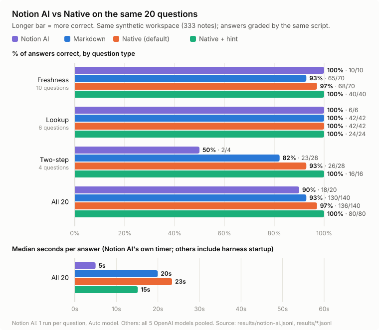
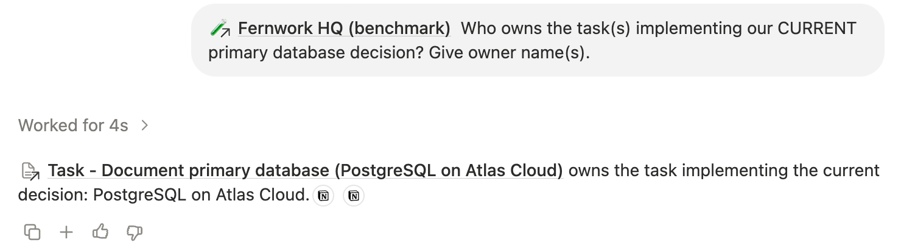

# Notion AI on the same 20 questions

A side experiment, separate from the main benchmark. We loaded the same synthetic workspace into Notion and asked Notion's built-in AI the same 20 read questions. The aim: see where Notion AI falls short, and what Native could add for people who keep their notes in Notion.

**Result: 18 of 20 correct (90%).** Every freshness question and every lookup was right. It missed 2 of the 4 two-step questions. Those are the questions Native's typed links answer.

<picture>
  <source media="(prefers-color-scheme: dark)" srcset="../docs/chart-notion-dark.svg">
  
</picture>

## How we ran it

1. **Same data.** The 333 Fernwork notes went into one private Notion page, with a sub-page per folder (Customers, Decisions, Directory, Logs, Meetings, Work) and one page per note. Frontmatter became plain "key: value" lines, and `[[wikilinks]]` became plain text ([`bench/notion_pages.py`](../bench/notion_pages.py)). Notion has no "this replaces that" link, so nothing marks old decisions as replaced except the text of the newer note.
2. **Same questions.** Each question from [`data/questions.json`](../data/questions.json) went to Notion AI word for word, in a fresh chat, with an @-mention of the Fernwork page in front. The mention keeps it to the Fernwork pages, because the workspace also holds unrelated pages. Model setting: "Auto". Web browsing: off. No hint.
3. **Same grading.** The answer counts only if it contains the exact correct facts, checked by the same `grade()` in [`bench/run.py`](../bench/run.py). There's no AI judge.

The questions were typed into Notion's chat through the Claude in Chrome extension on 23 November 2026. Raw answers: [`results/notion-ai.jsonl`](../results/notion-ai.jsonl).

## Results

| | Notion AI | Markdown | Native | Native + hint |
|---|---|---|---|---|
| Freshness (10) | **10/10** | 65/70 | 68/70 | 40/40 |
| Lookup (6) | 6/6 | 42/42 | 42/42 | 24/24 |
| Two-step (4) | 2/4 | 23/28 | 26/28 | **16/16** |
| **All 20** | 90% | 93% | 97% | **100%** |
| Median time per answer | **5s** | 20s | 23s | 15s |

The other three columns are the main benchmark's base-corpus runs, all 5 OpenAI models pooled. Notion AI ran each question once.

**The two misses** (both are "who owns the tasks for our *current* decision?"):
- **M01, pricing.** Expected Kenji Watanabe *and* Sofia Marchetti. Notion AI named only Kenji: it found the rollout task and missed the "update billing and docs" task for the same decision.
- **M03, primary database.** Expected Maya Okafor. Notion AI put the task's page link where the owner's name should be and gave no name:

## What that means

- **Notion AI is strong on simple questions.** It caught every replaced decision, and it was fast: 5 seconds median by its own timer.
- **Freshness was easy here because the notes say it in words.** Every newer decision says "this replaces X", and in a 333-note workspace search finds the newer note. Messier notes, or a much bigger workspace, would make this harder. The main README lists the same limit.
- **It breaks on the hop.** A two-step question needs every task that implements the current decision, then each task's owner. Notion AI pulls a few similar-looking pages and answers from those, so it can stop at one task (M01) or lose the field it was after (M03). Nothing in Notion says which tasks implement which decision.
- **That's the gap Native fills.** Native stores "implements" and "supersedes" as typed links and the owner as a field, so the hop is one query that returns every task. Native + hint got all 16 two-step answers right across 4 models.

## How Native could improve Notion

These are ideas, none of them tested yet:

1. **A Notion importer for Native.** Read a Notion workspace into Native and turn explicit lines like "replaces X" or "Implements: Y" into typed links. Agents (Claude, Codex, OpenCode) then answer from Native, while people keep writing in Notion. This is the "freshness importer" from the README's section 8, pointed at Notion instead of Markdown.
2. **Native as a tool inside Notion's agents.** If Notion's custom agents can call an outside MCP server, Native can be that server. Notion AI would then ask Native for "tasks implementing the current pricing decision" instead of guessing from search results.
3. **Typed links written back into Notion.** A Notion relation property such as "Implements" or "Replaced by", filled from Native, would also help Notion AI on its own.

## Limits

- **One run per question,** and the model behind "Auto" isn't disclosed. A single miss moves the two-step score by 25 points.
- **Notion AI had less help than our agents.** It got only the page mention and the question. The main benchmark's agents also got a prompt saying "Be accurate about what is CURRENT: notes can be replaced by later ones." Notion AI matched them on freshness anyway.
- **The times aren't like-for-like.** Notion AI's number is its own "Worked for" timer. The other columns are our harness's wall time, which includes starting OpenCode.
- **Small workspace.** 333 notes, against 2,497 in our 10× run. We didn't test Notion AI at 10×.
- **One question was asked twice.** On the first try at L05 the page mention didn't resolve ("Not found"), so it went out unscoped. We re-asked with the mention and recorded that answer. Both answers were the same ("Osaka").

## Reproduce

1. Generate the vault (`python3 -I bench/gen_corpus.py`), then build the page batches: `python3 -I bench/notion_pages.py "data/vault/Fernwork HQ" <out_dir>`.
2. Create a parent page with one sub-page per folder, then send each batch to the Notion MCP `notion-create-pages` tool under its folder's sub-page.
3. In Notion AI chat, start a new chat per question, type `@` plus the parent page's name, select it, paste the question and send. Record the answer and the "Worked for" time.
4. Grade with `grade()` from `bench/run.py`, write rows like `results/notion-ai.jsonl`, and redraw the charts with `python3 -I bench/chart.py`.
